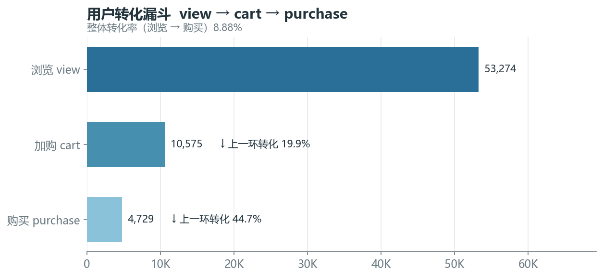
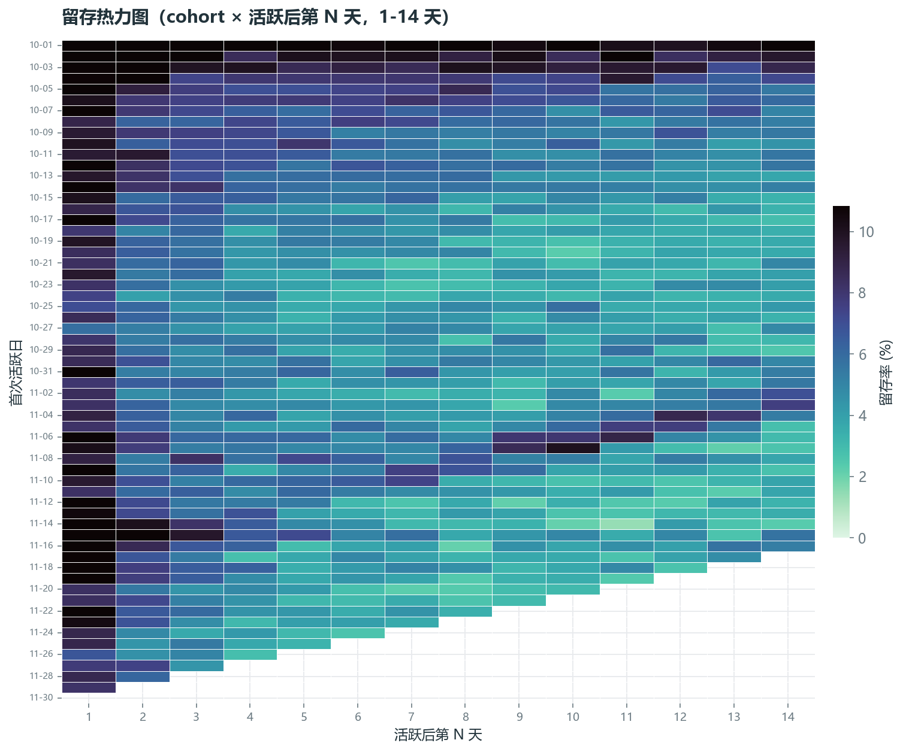
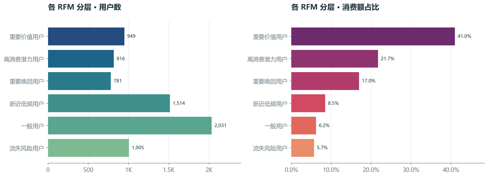
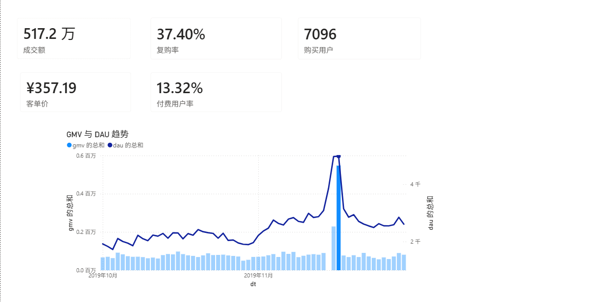
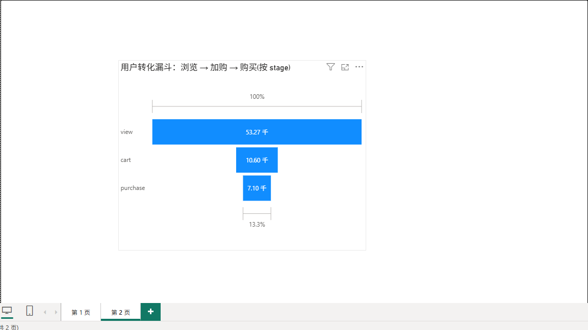
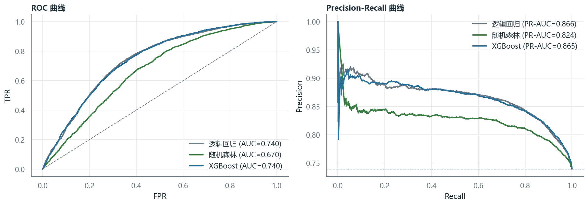
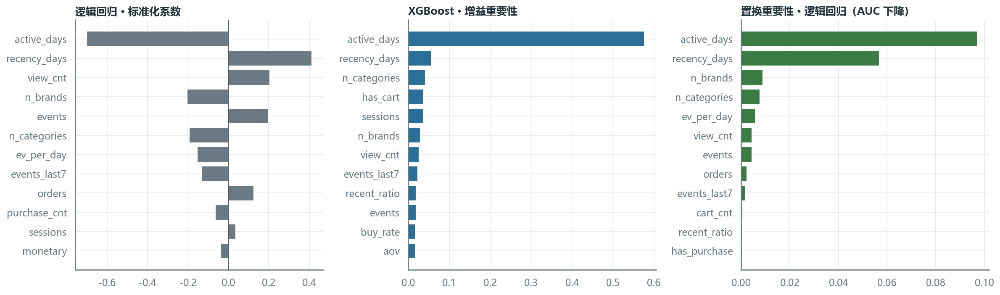
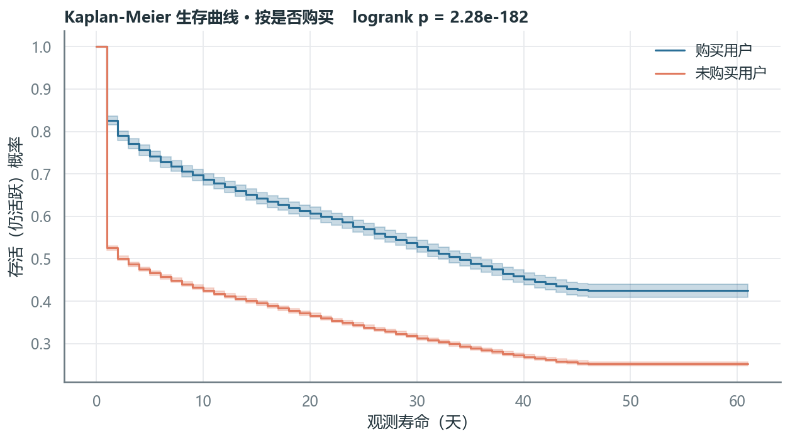

# 电商用户行为分析 

基于多品类电商用户行为数据（千万级，按用户抽样约 110 万行），完成 **数据清洗 → 指标体系 → A/B 实验 → 流失预测** 的端到端分析闭环。

> 数据来源：Kaggle [REES46 *eCommerce behavior data from multi category store*](https://www.kaggle.com/datasets/mkechinov/ecommerce-behavior-data-from-multi-category-store)，时间范围 2019-10 ~ 2019-11。

---

## 分析闭环

```
统一数据底座（user_behavior_clean）
        │
        ▼
[模块1] 行为与留存   ── 漏斗 / 留存 / RFM 分层        ┐ 看清现状
        │                                            │
        ▼                                            │
[模块2] 指标体系与看板 ── 北极星 GMV / BI 大盘        ┘
        │（从数据中发现问题：浏览→加购仅 19.9%）
        ▼
[模块3] A/B 测试     ── 假设 / 样本量 / 检验          ┐ 推动改变
        │                                            │
        ▼                                            │
[模块4] 流失预测     ── 特征工程 / 模型 / 归因        ┘
        │（高风险用户 → 干预 → 回模块3验证、模块2监控）
        └──────────────► 闭环
```

## 技术栈

- **SQL（MySQL）**：建表、清洗、漏斗 / 留存 / RFM、指标宽表
- **Python**：pandas / numpy、scikit-learn、XGBoost、lifelines、scipy、matplotlib / seaborn
- **BI**：Power BI Desktop（直连 MySQL）

## 目录结构

```
├── sql/                 # 01-08：建表、清洗、EDA、漏斗、留存、RFM、指标
├── notebooks/           # 模块1 行为分析、模块4 流失预测
├── ab_test/             # 模块3 实验方案 + 模拟检验
├── dashboard/           # 指标字典 + Power BI 看板截图
├── reports/
│   ├── figures/         # 全部分析图
│   ├── sql_outputs/     # 结果表 CSV + 高风险用户名单
│   └── final_report.md  # 整合分析报告
└── scripts/             # 抽样、结果导出
```

---

## 模块成果

### 模块 1 · 行为与留存分析

- **转化漏斗**：浏览 53,274 → 加购 10,575（19.9%）→ 购买 4,729（44.7%），整体浏览→购买 8.9%。**浏览→加购是最大流失环节**。
- **留存**：次日 10.4%、7 日 5.2%、30 日 4.7%，首周快速衰减后趋稳。
- **RFM 分层**：重要价值用户占 13.4% 却贡献 41% 消费额；价值 Top 3 分层（约 36% 用户）贡献约 80% GMV。

| 转化漏斗 | 留存热力图 | RFM 分层 |
| --- | --- | --- |
|  |  |  |

### 模块 2 · 指标体系与 BI 看板

- **北极星指标 GMV** = 5,172,468；付费用户 7,096（13.3%）、客单价 357.19、ARPPU 728.93、复购率 37.4%。
- 指标字典与口径见 [dashboard/metrics_dictionary.md](dashboard/metrics_dictionary.md)，看板由 Power BI 直连 MySQL 构建。
- **异常归因**：11/17 的 GMV 尖峰经逐日拆解确认为**数据假象**——11/15 购买采集中断（当日 0 单），订单补录至 16–17 日，11/17 转化率被推高至 23%（远超 6%–10% 的合理区间）。

| 总体趋势看板 | 转化漏斗看板 |
| --- | --- |
|  |  |

### 模块 3 · A/B 测试

- 针对模块 1 的瓶颈「浏览→加购」（基线 19.9%）设计实验。观测数据无真实分组，**实验数据按设计参数模拟**，展示完整方法论。
- 设计：用户级 50/50，MDE +2pp，α=0.05（双侧），power=0.80 → **每组样本量 6,487**。
- 验证：闭式功效 0.800，蒙特卡洛经验第一类错误率 0.0507、经验功效 0.8029，卡方 χ² 与 z² 一致。
- 方案见 [ab_test/ab_test_design.md](ab_test/ab_test_design.md)，模拟检验见 [ab_test/module3_ab_simulation.ipynb](ab_test/module3_ab_simulation.ipynb)。

### 模块 4 · 流失预测

- **标签**（非合约式流失）：特征窗 10/01–11/14 → 跳过数据污染窗 15–17 → 标签窗 11/18–30 无活动即流失。
- **分类**：逻辑回归与 XGBoost 表现相当（AUC 0.740，PR-AUC 0.866 / 0.865）。
- **归因**（系数 / 增益 / 置换 / SHAP 一致）：**活跃天数是首要保护因素、recency 是首要风险因素**，参与广度（会话数、品类数）显著降低流失，消费金额影响较弱——流失主要由参与度决定。
- **生存分析**：Cox 显示会话数、品类数显著降低流失风险；购买 vs 未购买生存曲线差异显著（logrank p = 2.28e-182）。
- **闭环**：高风险高价值名单（200 人，约占 GMV 19%）输出至 [reports/sql_outputs/churn_high_risk_users.csv](reports/sql_outputs/churn_high_risk_users.csv)。

| ROC / PR | 流失驱动因素 | KM 生存曲线 |
| --- | --- | --- |
|  |  |  |

---

## 复现

```bash
# 1. 环境
conda create -n sqleco python=3.10 pandas numpy matplotlib seaborn scikit-learn scipy ipykernel pymysql sqlalchemy
conda activate sqleco
conda install -c conda-forge xgboost lifelines shap

# 2. 抽样（原始 CSV 放 data/raw/）
python scripts/sample_by_user.py --rate 0.01

# 3. SQL：按顺序执行 sql/01 → 03 → 05 → 06 → 07 → 08（04 为 EDA，可选）

# 4. 导出结果表 / 跑 notebook
python scripts/export_results.py --user root --password <pwd>
#   notebooks/module1_behavior.ipynb、notebooks/module4_churn.ipynb（内核选 sqleco）
```

完整分析报告见 [reports/final_report.md](reports/final_report.md)。
