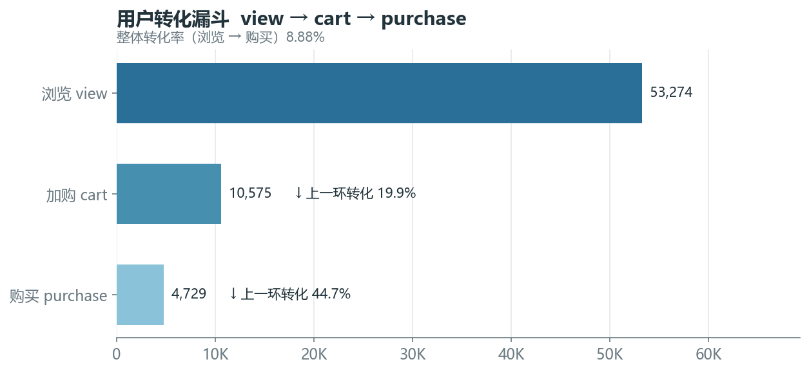
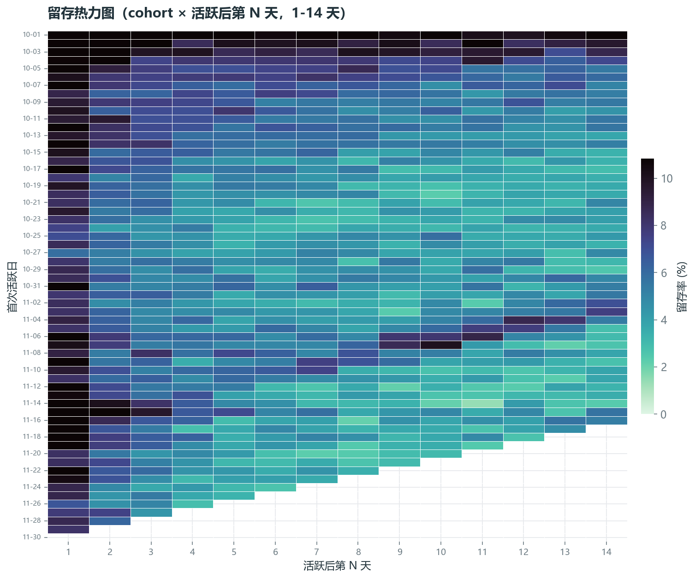
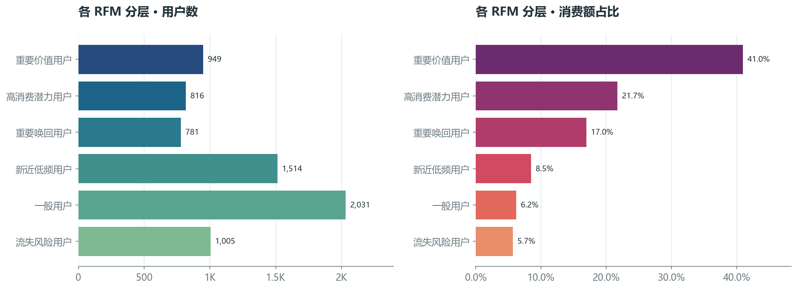
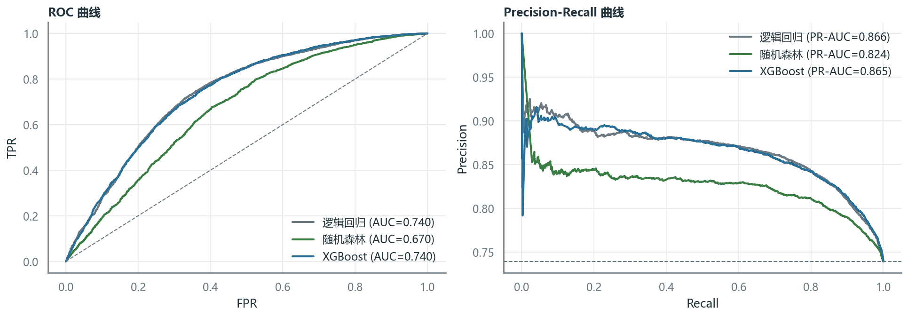
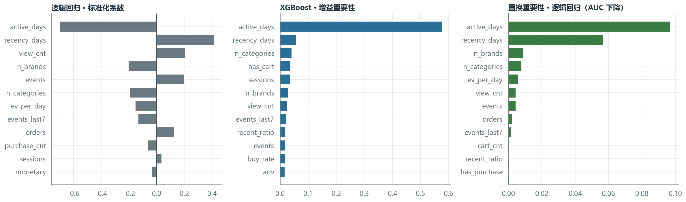
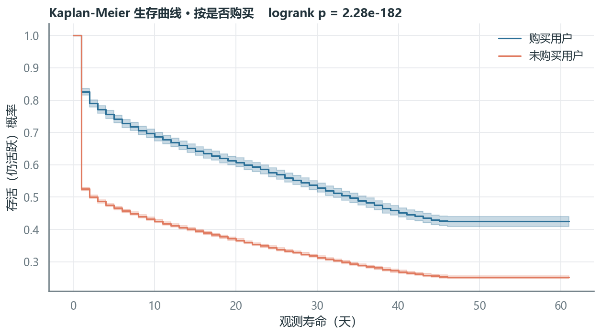

# 电商用户行为分析 · 整合报告

## 摘要

基于多品类电商用户行为数据（2019-10 ~ 2019-11，按用户抽样约 110 万行、约 5.3 万用户），围绕「现状 → 度量 → 实验 → 预测」完成一条分析闭环：用户从浏览到加购的转化是主要瓶颈（19.9%）；GMV 等核心指标已指标化并发现一处数据采集异常；针对加购瓶颈给出可执行的 A/B 实验方案；流失预测显示用户流失主要由参与度（活跃天数、会话与品类广度）而非消费金额决定，并产出高风险高价值用户名单回流运营。

---

## 1. 数据与口径

- **数据源**：REES46 多品类电商行为数据集，字段含 `event_time / event_type(view/cart/purchase) / product_id / category_id / category_code / brand / price / user_id / user_session`。
- **清洗**：去重、UTC 时间解析与日期/小时拆分、过滤 `price<=0` 与区间外脏数据、缺失值（category_code / brand / user_session）统一填充。清洗后约 110.8 万行（去除约 0.38%）。
- **口径要点**：该数据集仅含 view / cart / purchase 三类行为（无 remove_from_cart）；金额采用真实 `price`；订单数以购买事件去重 `user_session` 近似。

## 2. 现状：行为与留存（模块 1）

**转化漏斗（用户级，严格顺序）**

| 环节 | 用户数 | 环节转化率 |
| --- | --- | --- |
| 浏览 | 53,274 | — |
| 加购 | 10,575 | 19.9% |
| 购买 | 4,729 | 44.7% |

整体浏览→购买 8.9%。加购→购买相对健康，**主要漏损在浏览→加购**。

**留存**：次日 10.4%、7 日 5.2%、30 日 4.7%，呈"首周快速衰减、之后沉淀小批稳定用户"形态，干预窗口应集中在激活后头 7 天。

**RFM 分层**：重要价值用户占 13.4%，贡献 41.0% 消费额；价值 Top 3 分层（重要价值 + 高消费潜力 + 重要唤回，约 36% 用户）贡献约 80% GMV，呈明显的二八结构。

## 3. 度量：指标体系与异常（模块 2）

以 **GMV 为北极星指标**，拆解链路 `GMV = DAU × 付费用户率 × 客单价`，并落为按天指标宽表与全期 KPI（见 [../dashboard/metrics_dictionary.md](../dashboard/metrics_dictionary.md)）。

| 指标 | 值 |
| --- | --- |
| GMV | 5,172,468 |
| 付费用户 / 付费用户率 | 7,096 / 13.3% |
| 客单价 AOV / ARPPU | 357.19 / 728.93 |
| 复购率 | 37.4% |

**异常归因**：趋势图上 11/17 的 GMV 尖峰经逐日拆解确认为数据采集问题而非真实业绩——

| 日期 | events | purchase_users | GMV | 浏览→购买转化率 |
| --- | --- | --- | --- | --- |
| 11-15 | 63,780 | 0 | 0 | 0.00% |
| 11-16 | 65,404 | 492 | 228,894 | 9.93% |
| 11-17 | 64,160 | 1,143 | 546,957 | 23.01% |

11/15 行为量翻倍但购买为 0（购买采集中断），订单补录至 16–17 日，使 11/17 转化率被推高到不合理的 23%。该窗口在趋势分析中作为污染区处理，单日 GMV / 转化率不参与环比。

## 4. 实验：A/B 测试（模块 3）

针对模块 1 的瓶颈「浏览→加购」（基线 19.9%）设计实验评估一项加购引导改动。

> 该数据为观测数据，无真实实验分组，不能直接做因果推断；本模块按设计参数模拟两组数据以展示完整方法论，仅实验结局为模拟，基线与瓶颈来自真实数据。

- **设计**：用户级 50/50 随机；主指标浏览→加购转化率；护栏指标加购→购买、人均 GMV；MDE 绝对 +2pp；α=0.05（双侧）、power=0.80。
- **样本量**：两比例检验推导得每组约 **6,487**（合计约 13,000）。
- **方法校验**：闭式功效 0.800；蒙特卡洛（各 2 万次）经验第一类错误率 0.0507、经验功效 0.8029；卡方 χ² 与 z² 完全一致。
- **决策规则**：主指标显著为正且护栏不显著恶化方建议上线；上线先核对 SRM，不做无校正的中途窥视。

详见 [../ab_test/ab_test_design.md](../ab_test/ab_test_design.md) 与模拟 notebook。

## 5. 预测：流失模型与归因（模块 4）

**标签（非合约式流失）**：特征窗 2019-10-01 ~ 11-14 构造特征，跳过数据污染窗 15–17，标签窗 11-18 ~ 11-30 内无任何行为即判为流失。整体流失率约 74%（购买用户 61.5% 低于未购买 75.6%，且流失率随 recency 单调上升）。

**分类**：逻辑回归与 XGBoost 表现相当（AUC 0.740，PR-AUC 0.866 / 0.865），随机森林较弱（AUC 0.670）。三模型可靠性曲线均位于对角线上方，即受类别平衡加权影响系统性低估流失概率；若将输出作为绝对概率使用需再做 Platt / Isotonic 校准。

**归因**：逻辑回归系数、XGBoost 增益、置换重要性与 SHAP 四者一致——**活跃天数是首要保护因素、recency 是首要风险因素**，参与广度（会话数、浏览品类数）显著降低流失，消费金额影响较弱。

**生存分析**：将流失视为 time-to-event 并处理删失（研究末期仍近期活跃者为删失）。Cox 模型显示会话数（log HR ≈ −1.3）、浏览品类数（≈ −0.6）显著降低流失风险；Kaplan-Meier 下购买与未购买用户生存曲线差异显著（logrank p = 2.28e-182）。

## 6. 闭环与运营建议

- **高风险高价值名单**：以流失概率 × 价值排序，输出 200 名用户（合计消费额约 98.7 万，约占全期 GMV 19%）至 [sql_outputs/churn_high_risk_users.csv](sql_outputs/churn_high_risk_users.csv)。
- **干预闭环**：对该群体优先做召回触达 / 加购引导；干预手段回到模块 3 以 A/B 实验验证因果效果，上线后纳入模块 2 看板持续监控。
- **留存抓手**：模型与生存分析一致指向"参与度"——提升活跃频次、拓展浏览品类比单纯促成交更能降低流失；加购环节（浏览→加购 19.9%）是同时改善转化与参与度的优先优化点。

## 7. 局限与改进

- **抽样规模**：当前为 1% 用户抽样，结论方向稳健，绝对量级需以全量复核。
- **数据质量**：11/15–17 的采集异常已识别并隔离；建议在生产中加入指标级数据质量监控。
- **因果限制**：A/B 部分为模拟，真实因果效应需线上实验确认。
- **模型校准**：分类概率偏低估，作绝对概率使用前需重校准；流失标签的窗口长度与"无活动"口径可做敏感性分析。
- **特征扩展**：可纳入价格敏感度、时段偏好、品类序列等更细特征，并尝试 BG/NBD 等非合约式概率模型与生存模型做交叉验证。
